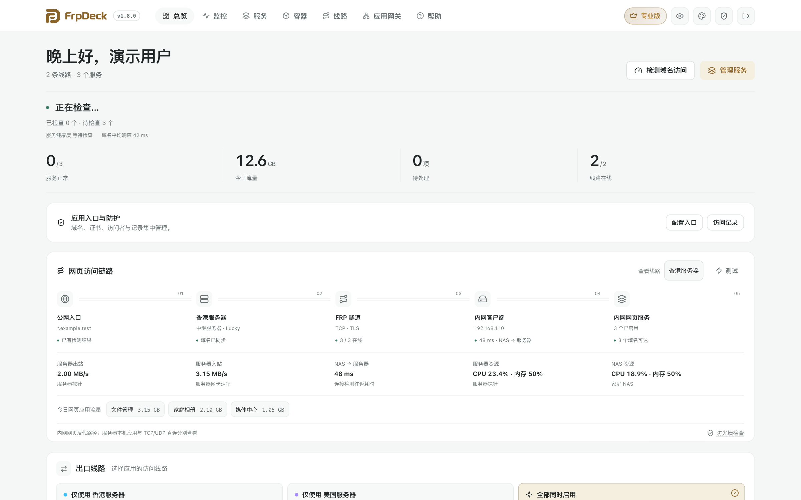
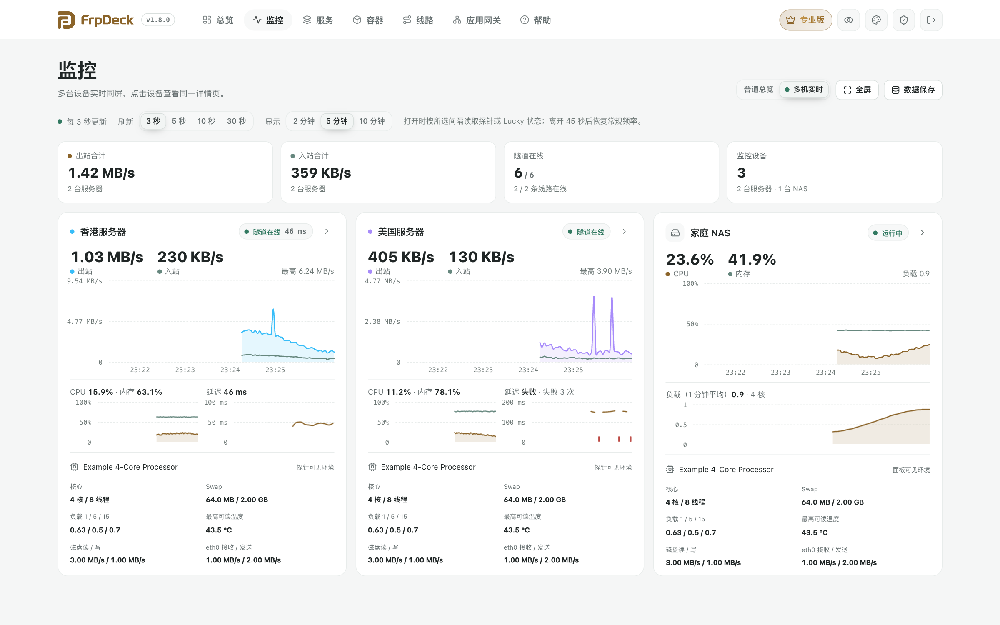
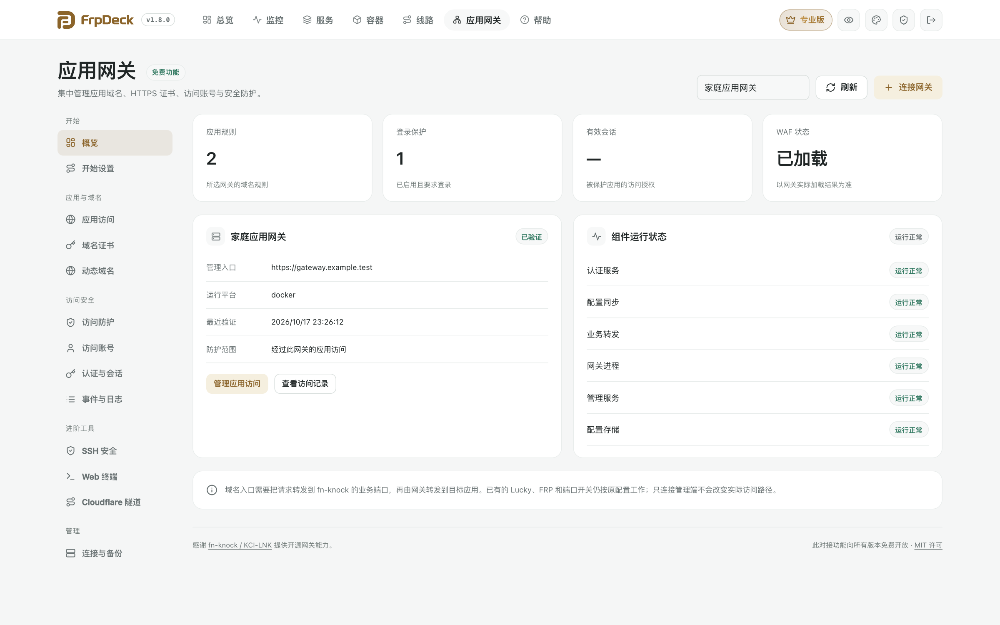

# FrpDeck 版本记录

FrpDeck 是面向 NAS 的 frp 图形化管理面板，支持通用 Docker / Compose 部署和飞牛应用中心安装。本仓库提供安装说明、公开版本更新记录和问题反馈，不包含应用源码。

**群晖、威联通、极空间、绿联、Unraid 及 Linux 用户请查看 [Docker / Compose 安装与更新](docs/INSTALL.md)。** 飞牛用户也可在应用中心搜索 FrpDeck 安装与更新，各渠道以实际显示版本为准。

- [完整版本记录](CHANGELOG.md)
- [GitHub Releases](https://github.com/songdone/FrpDeck-Release/releases)
- [官网](https://frpdeck.playsong.cn/)
- [问题反馈](https://github.com/songdone/FrpDeck-Release/issues)

当前版本记录：**1.8.7**。

[购买后激活与授权恢复](docs/activation-service-progress.md)：兑换重试、升级和换机说明。

本应用含付费功能，收费与飞牛官方无关。基础版永久免费，专业版与家庭版的功能及授权说明以应用内授权页和官网为准。

## 安装入口

- [Docker / Compose 安装、首次登录、完整备份与更新](docs/INSTALL.md)：使用 `registry-1.docker.io/666uos/frpdeck:latest`，也可固定为 `:1.8.7`；默认面板端口 `15566:5000`，数据持久化到 `/data`。
- [官网从零部署教程](https://frpdeck.playsong.cn/guide.html)：包含服务器、frps、Lucky、线路和服务配置。
- 飞牛应用中心：搜索 FrpDeck。官网与本仓库不提供独立 FPK 下载。

通用 Docker / Compose 部署不提供 60 天体验；飞牛应用中心安装可领取 60 天专业版体验。体验到期固定一条保留线路运行，其余停用并保留配置，基础版不可切换，原永久授权不受影响。官网和 GitHub 的版本记录不代表所有渠道已经同步更新。

更新前请停止主程序并备份完整数据目录及部署配置；仅导出配置不能替代完整备份。Docker 用户拉取新镜像后需重建原容器，保留原数据、参数和 Docker 环境。

## 1.8.7 更新

- 修复长期运行的 Docker 连接与内存累积，完善 Lucky 清理重试、配置保存及迁移失败保护。
- 飞牛新安装可在向导设置管理员账号；已有账号和授权保留，体验沿用原截止时间。
- 修正运行状态、断线、保存和同步反馈，明确配置导出与完整备份的区别。
- 优化激活查询与错误提示，减少重复操作。
- 保留完整数据目录升级；已有 1.8.4/1.8.5 探针无需因本次主程序修复重装。

[查看完整更新说明](docs/release-1.8.7.md)

## 1.8.6 更新

- 恢复流量占比环图，修复上传、下载切换后的合计与占比显示。
- 完善未归属分类、探针状态与趋势说明，改善手机端布局和授权恢复指引。
- 保留原数据目录升级即可，已有 1.8.4 / 1.8.5 探针无需为本次更新重装。

[查看完整更新说明](docs/release-1.8.6.md)

## 1.8.5 更新

- 授权页可直接打开专业版、家庭版商品页购买，买完拿到兑换码。
- 兑换码在本机激活：先显示版本和剩余名额，确认后才生效，不用再复制机器码发给作者。
- 家庭版一个码最多绑定 3 台 NAS，可分次添加；保留原安装数据与Docker环境可恢复原授权，不占新名额。
- 专业版可升级为家庭版，家庭版不会被误降级；名额用完会提示联系作者。
- 兑换码功能需要授权服务同步更新，未更新时购买入口和原有授权码激活照常可用。
- NAS 流量分析改为汇总条 + 应用列表 + 识别情况 + 趋势；应用行可展开看下载/上传占比。统计口径不变。

[查看完整更新说明](docs/release-1.8.5.md)

## 1.8.4 更新

- 改善 NAS 公网流量的显示：下载与上传分开统计，趋势图按方向拆色。
- 出站连接按用途归类，减少「其他」占比；Docker 端口映射补上容器名。
- 修复 frps 重启后当天流量少算、跨天重置被摊到前一天的问题。
- 更新主程序即可，出站分类和网卡对照需要同时更新 NAS 探针。

[查看完整更新说明](docs/release-1.8.4.md)

## 1.8.3 更新

- 修复流量图表错误提示面板停止的问题。
- 优化估算说明和历史统计记录的展示。
- 更新主程序即可，已有兼容探针可继续使用。

[查看完整更新说明](docs/release-1.8.3.md)

## 1.8.2 更新

- 改善 NAS 本地 Lucky 的流量统计与旧版连接兼容性。
- 优化流量来源提示、配置保存与异常恢复。
- 提升登录安全和线路运行稳定性。

[查看完整更新说明](docs/release-1.8.2.md)

## 1.8.1 更新

- 改善 NAS 公网流量统计和历史记录连续性。
- 优化不同网络环境下的识别与显示。
- 修复域名规则同步的兼容问题。

[查看完整更新说明](docs/release-1.8.1.md)

## 1.8.0 更新

- 免费连接独立部署的 fn-knock 应用网关，原 Lucky 可继续使用。
- 单页设备详情整合运行指标、趋势、流量及硬件明细；普通总览和多机实时共用详情。
- 完善 IPv6、Docker 地址、配置导入及服务状态判断。
- 体验到期固定一条保留线路，其余配置保留；原永久授权不受影响。

升级前请备份完整数据目录。详见 [1.8.0 升级说明](docs/release-1.8.0.md)。应用中心以实际可用版本为准。

## 界面

以下为 1.8.0 实际界面，使用示例数据。

