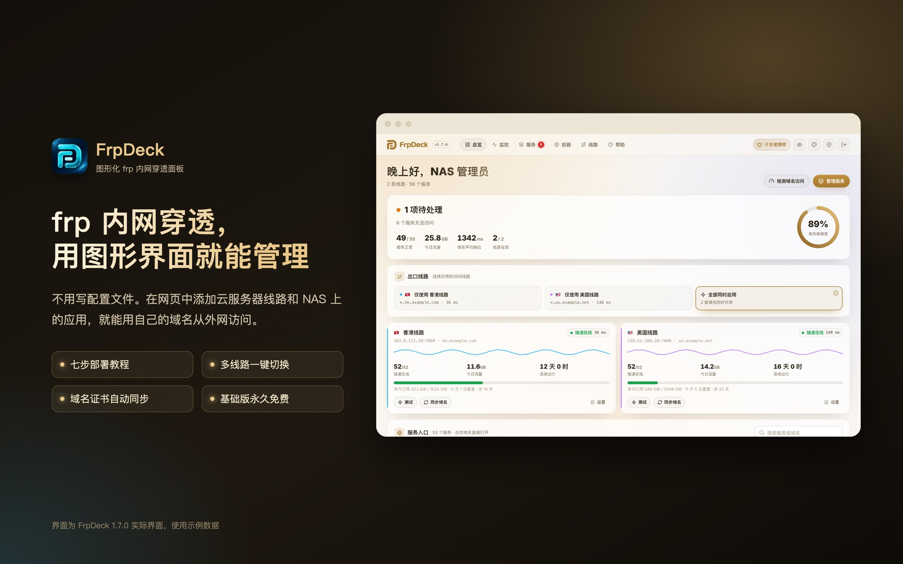
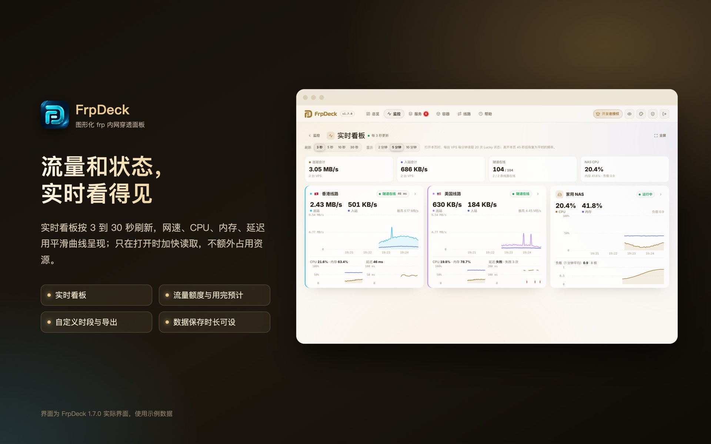
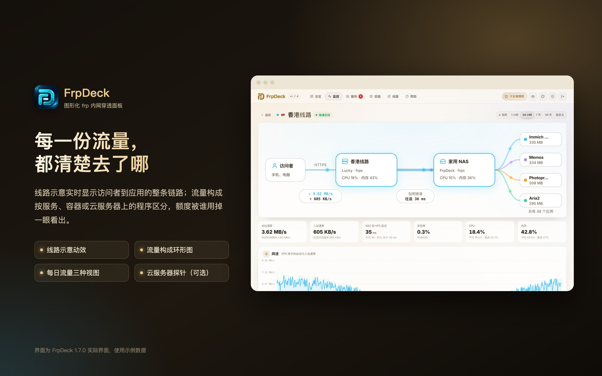
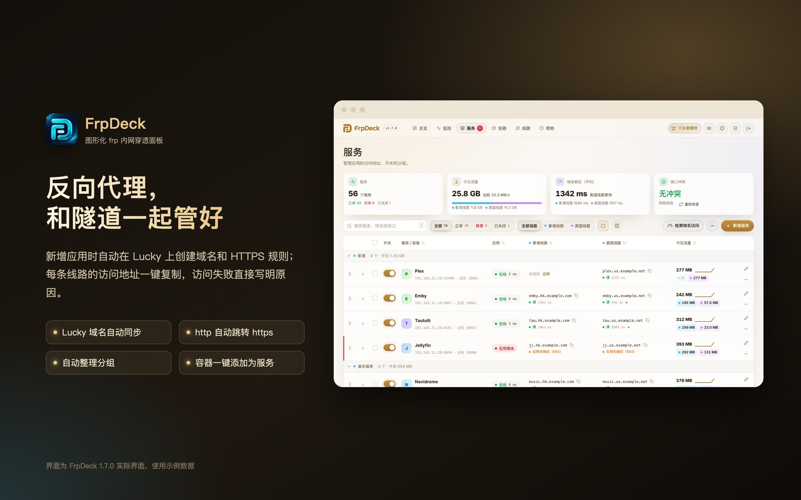
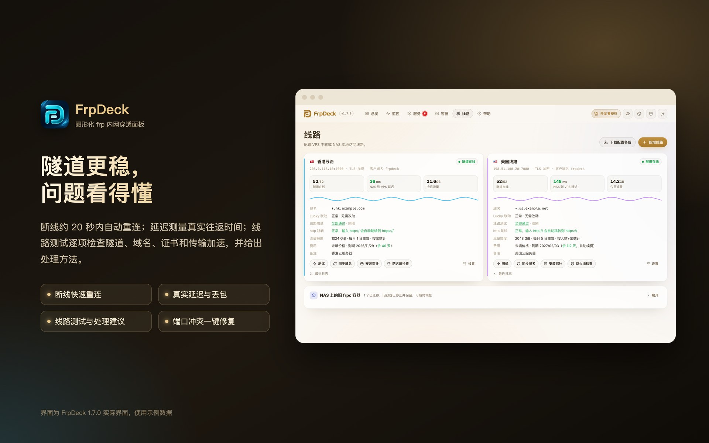

# FrpDeck

**本应用含付费功能，收费与飞牛官方无关。** FrpDeck 是 frp 内网穿透的图形化管理面板，为不熟悉配置文件的用户设计：在网页中添加云服务器线路和 NAS 上的应用，就能通过自己的域名从外网访问；自动同步 Lucky 域名与 HTTPS 证书，实时查看每条线路的流量与状态。

本仓库用于发布安装包、更新说明和收集反馈，不包含应用源码。

[官网](https://frpdeck.playsong.cn/) · [部署教程](https://frpdeck.playsong.cn/guide.html) · [最新发布](https://github.com/songdone/FrpDeck-Release/releases/latest) · [安装说明](docs/INSTALL.md) · [问题反馈](https://github.com/songdone/FrpDeck-Release/issues)

## 下载

当前版本：**1.7.2**，内置 frpc **0.64.0**。

| 部署方式 | 下载或镜像 | 说明 |
|---|---|---|
| Docker / Compose | `registry-1.docker.io/666uos/frpdeck:latest`；[Compose 配置](https://github.com/songdone/FrpDeck-Release/releases/download/v1.7.2/docker-compose-1.7.2.yaml) | 适用于群晖、威联通、极空间、飞牛、绿联等带 Docker 的 NAS 和 Linux 主机 |
| 飞牛 fnOS | 飞牛应用中心（内测中）；手动安装包 [FrpDeck-1.7.2-fnos.fpk](https://github.com/songdone/FrpDeck-Release/releases/download/v1.7.2/FrpDeck-1.7.2-fnos.fpk) | 从飞牛应用中心安装可免费体验专业版 60 天 |
| 文件校验 | [SHA256SUMS.txt](https://github.com/songdone/FrpDeck-Release/releases/download/v1.7.2/SHA256SUMS.txt) | 下载后核对文件完整性 |

镜像支持 amd64、arm64、arm/v7 架构；amd64 和 arm64 已实际运行验证，arm/v7 尚未在实体设备上验证。

需要自行准备 VPS（安装 frps）、域名和 Lucky；家里有可用的公网 IPv6 时，也可以只用 NAS 上的 Lucky，不经过 VPS。FrpDeck 不提供 VPS、域名或流量。

## 1.7.2 升级提示

本次新增可配置失败登录防护、来源 IP 与浏览器记录、有效会话及单独退出，以及可授权自动执行的 VPS 网页端口开关。首次升级后需重新登录；VPS 执行器和旧手动防火墙需单独迁移，默认保护 SSH、VPN 与 FRP 控制通道。[安全设置与迁移说明](https://github.com/songdone/FrpDeck-Release/releases/download/v1.7.2/security-and-firewall-1.7.2.md)。

## 安装

下载 Compose 配置放入专用目录，按[安装说明](docs/INSTALL.md)启动，然后在浏览器中打开 `http://NAS地址:15566`。首次设置需要的初始密码在容器日志和数据目录的 `initial-password.txt` 中。VPS、Lucky、域名和证书的完整步骤见[部署教程](https://frpdeck.playsong.cn/guide.html)。

数据目录保存管理员、线路、服务和授权，升级和重建容器时请保留。

## 界面

截图来自 FrpDeck 1.7 实际界面，数据为示例。

## 功能与价格

- 线路与服务：管理多条 frp 线路和 NAS 服务，联动 Lucky 创建和开关域名规则，每条线路使用各自的域名。
- 状态与诊断：检查隧道、域名、HTTPS 证书、外网访问和端口，并给出处理建议。
- 流量与提醒：流量趋势、流量去向、额度与计费方式、到期提醒。
- 消息推送（所有版本免费）：企业微信、钉钉、飞书、Server酱、Bark、Telegram 和通用 Webhook。
- 专业版功能：多条线路一键切换、容器与 VPS 端口发现并一键加入反代、端口冲突一键修复、迁移旧的 frpc 容器。
- 使用与安全：电脑和手机界面、可安装为应用、深浅主题、两步验证、登录限流、仅允许局域网访问。

| 版本 | 首发价 | 正常售价 | 可激活的 NAS | 线路 / 服务 |
|---|---|---|---|---|
| 基础版 | 免费 | 免费 | 不限 | 1 条线路 / 服务数量不限 |
| 专业版 | **¥8.8** | ¥18 | 1 台 | 不限 / 不限 |
| 家庭版 | **¥18** | ¥28 | 3 台 | 不限 / 不限 |

购买的授权永久有效，包含后续版本更新，激活后验证无需联网。专业版与家庭版功能相同，区别是可激活的 NAS 数量。VPS、域名等费用由用户自行承担。[许可协议](LICENSE) · [第三方组件说明](THIRD_PARTY_NOTICES.md) · [购买与售后](https://t.me/Play_6uos)

## 授权

- 机器码由本次安装和本机 Docker 共同生成。购买时将「授权」页的机器码发给作者，收到授权码后在同一页面粘贴激活。
- 升级或重建容器时保留数据目录，授权继续有效；清空数据目录或更换 Docker 后机器码会改变，请联系作者换绑。
- 活动资格码须在截止时间前在「授权」页联网兑换，兑换后得到永久授权。同一 Docker 环境在所有活动中只能领取一份授权。当前没有进行中的活动。
- 兑换资格码、领取飞牛体验时，FrpDeck 向 `fdkey.playsong.cn` 发送安装编号、Docker 编号和资格码，不发送线路、服务配置、VPS 令牌或流量记录。

## 飞牛 60 天专业版体验

从飞牛应用中心安装的 FrpDeck 完成管理员设置后，会联网领取 60 天专业版体验，到期后恢复为基础版，配置和线路保留。同一 Docker 环境只能体验一次，重装或清空数据不会重新计算。通过 Docker 命令或 Compose 部署的 FrpDeck 不提供体验。

## 权限与数据

随附的 Compose 配置映射了 `/var/run/docker.sock`，用于发现容器、迁移旧的 frpc 容器和生成机器码。映射后 FrpDeck 可以管理本机 Docker，末尾的 `:ro` 不限制管理操作。只使用基础版时可以删除该行，此时容器发现与迁移不可用，也无法激活授权。

线路凭据、管理员信息和授权保存在本机数据目录。只有开启消息推送后，FrpDeck 才会向所配置的推送服务发送通知。详见[官网许可与隐私页](https://frpdeck.playsong.cn/legal.html)。

## 更新与反馈

[更新记录](CHANGELOG.md) · [常见问题](docs/FAQ.md) · [体验与授权](docs/体验与授权说明.md)

反馈时请说明 NAS 型号、系统、FrpDeck 版本、部署方式、操作步骤和实际表现。截图请遮挡服务器地址、账号、机器码和授权码，不要公开密码、OpenToken 或 Webhook 令牌。

FrpDeck 与 frp、Lucky 官方无关联。
