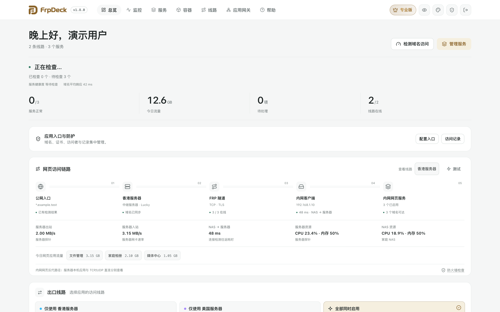
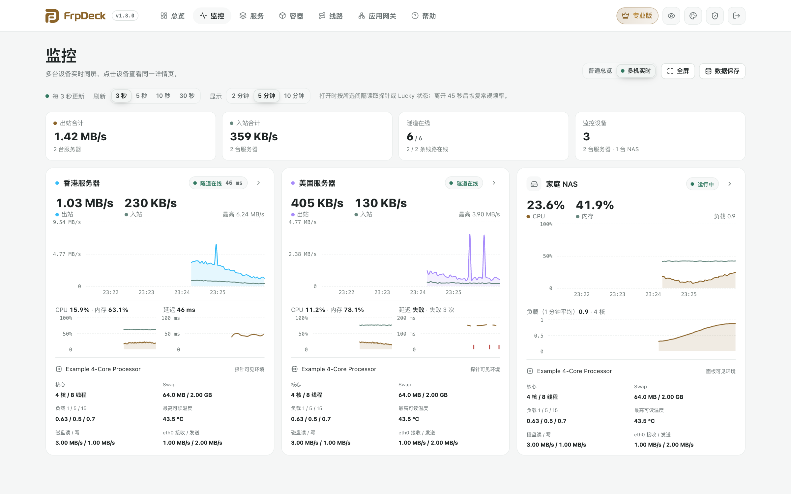
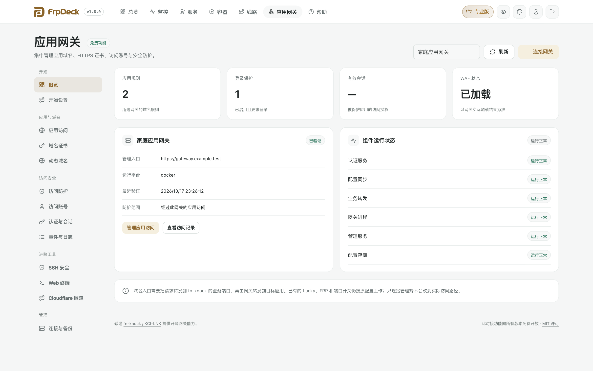

# FrpDeck 版本记录

FrpDeck 是面向 NAS 的 frp 图形化管理面板。本仓库用于公开版本更新记录和收集反馈，不包含应用源码，也不再提供安装包、Compose 文件或手动部署下载。

**安装与更新请通过飞牛应用中心，搜索 FrpDeck。** 各渠道的更新节奏可能不同，请以应用中心显示为准。

- [完整版本记录](CHANGELOG.md)
- [GitHub Releases](https://github.com/songdone/FrpDeck-Release/releases)
- [官网](https://frpdeck.playsong.cn/)
- [问题反馈](https://github.com/songdone/FrpDeck-Release/issues)

当前版本记录：**1.8.5**。

本应用含付费功能，收费与飞牛官方无关。基础版永久免费，专业版与家庭版的功能及授权说明以应用内授权页和官网为准。

## 分发方式调整

官网与本仓库仅公开版本记录和说明，历史安装附件已停止公开分发。已安装用户请保留原数据目录，通过原安装渠道维护更新。

官网和 GitHub 的版本记录不代表所有分发渠道已经同步更新。

## 1.8.5 更新

- 授权页可直接打开专业版、家庭版商品页购买，买完拿到兑换码。
- 兑换码在本机激活：先显示版本和剩余名额，确认后才生效，不用再复制机器码发给作者。
- 家庭版一个码最多绑定 3 台 NAS，可分次添加；同机重装后重新兑换会恢复原授权，不占新名额。
- 专业版可升级为家庭版，家庭版不会被误降级；名额用完会提示联系作者。
- 兑换码功能需要授权服务同步更新，未更新时购买入口和原有授权码激活照常可用。

[查看完整更新说明](docs/release-1.8.5.md)

## 1.8.4 更新

- 改善 NAS 公网流量的显示：下载与上传分开统计，趋势图按方向拆色。
- 出站连接按用途归类，减少「其他」占比；Docker 端口映射补上容器名。
- 修复 frps 重启后当天流量少算、跨天重置被摊到前一天的问题。
- 更新主程序即可，出站分类和网卡对照需要同时更新 NAS 探针。

[查看完整更新说明](docs/release-1.8.4.md)

## 1.8.3 更新

- 修复流量图表错误提示面板停止的问题。
- 优化估算说明和历史统计记录的展示。
- 更新主程序即可，已有兼容探针可继续使用。

[查看完整更新说明](docs/release-1.8.3.md)

## 1.8.2 更新

- 改善 NAS 本地 Lucky 的流量统计与旧版连接兼容性。
- 优化流量来源提示、配置保存与异常恢复。
- 提升登录安全和线路运行稳定性。

[查看完整更新说明](docs/release-1.8.2.md)

## 1.8.1 更新

- 改善 NAS 公网流量统计和历史记录连续性。
- 优化不同网络环境下的识别与显示。
- 修复域名规则同步的兼容问题。

[查看完整更新说明](docs/release-1.8.1.md)

## 1.8.0 更新

- 免费连接独立部署的 fn-knock 应用网关，原 Lucky 可继续使用。
- 单页设备详情整合运行指标、趋势、流量及硬件明细；普通总览和多机实时共用详情。
- 完善 IPv6、Docker 地址、配置导入及服务状态判断。
- 体验到期固定一条保留线路，其余配置保留；原永久授权不受影响。

升级前请备份完整数据目录。详见 [1.8.0 升级说明](docs/release-1.8.0.md)。应用中心以实际可用版本为准。

## 界面

以下为 1.8.0 实际界面，使用示例数据。

